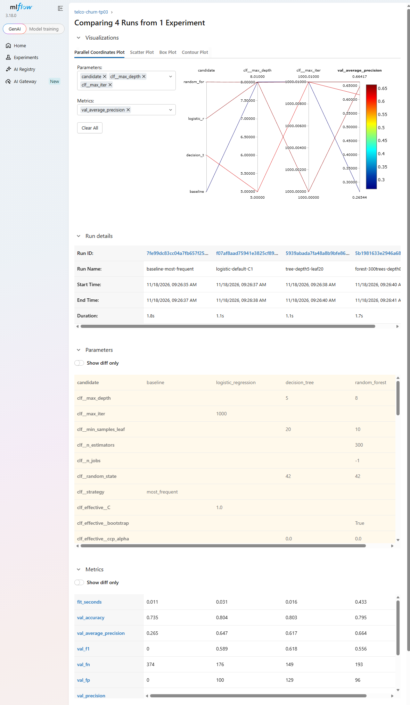
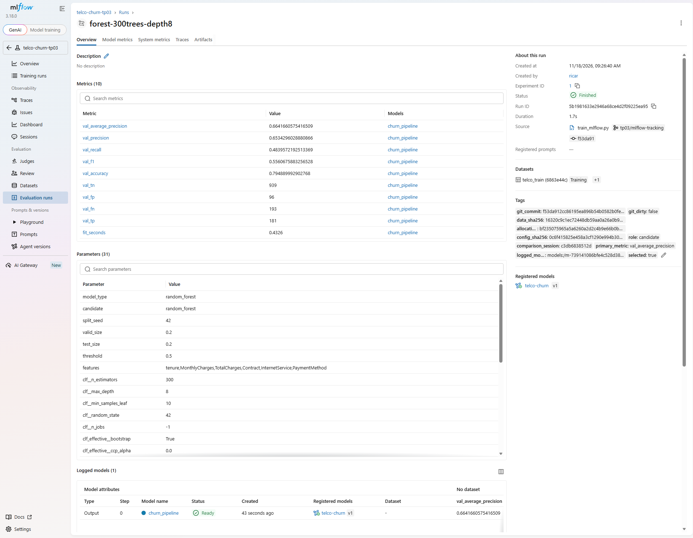
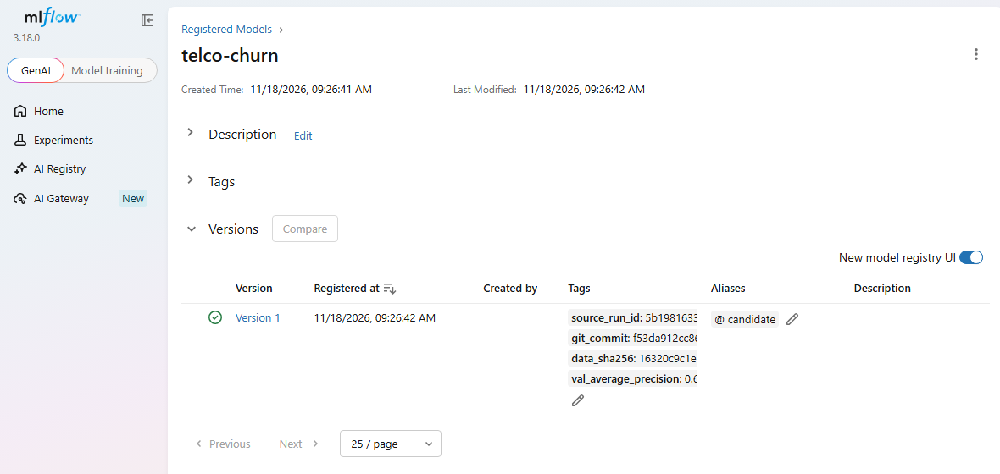

# TP03 summary: MLflow tracking, registry and recovery

Experiment `telco-churn-tp03` on a local tracking server (`http://127.0.0.1:5000`, SQLite backend `mlflow.db`, artifact store `mlartifacts/`). Same data, split, six features, preprocessing and threshold (0.5) as TP02. Primary metric: validation average precision, fixed in `configs/tp03.json` before the runs.

## 1. Candidate comparison



| Run ID | Candidate / changed setting | Validation AP | Validation recall | Validation F1 | Decision |
|---|---|---:|---:|---:|---|
| `TODO` | `baseline-most-frequent`: DummyClassifier, always predicts "No" | 0.2654 | 0.0000 | 0.0000 | Reference floor |
| `TODO` | `logistic-default-C1`: LogisticRegression, C=1, max_iter=1000 | 0.6475 | 0.5294 | 0.5893 | Rejected: 0.0167 AP below the best (outside the 0.01 tie tolerance) |
| `TODO` | `tree-depth5-leaf20`: DecisionTree, max_depth=5, min_samples_leaf=20 | 0.6173 | 0.6016 | 0.6181 | Rejected: lowest AP of the three |
| `TODO` | `forest-300trees-depth8`: RandomForest, 300 trees, max_depth=8, min_samples_leaf=10 | **0.6642** | 0.4840 | 0.5561 | **Selected** |

Same validation population for every run (1,409 customers, allocation hash recorded as `allocation_sha256`). Test set not evaluated.

## 2. Selected run



## 3. Registry



## 4. Identifiers

| Identifier | Value |
|---|---|
| Source run ID | `TODO` |
| Logged model URI | `TODO` |
| Registered model and version | `telco-churn` version `TODO` |
| Alias | `candidate` (`models:/telco-churn@candidate` --> version `TODO`) |
| Git commit | `TODO` (`git_dirty = false`) |
| Original data SHA-256 | `16320c9c1ec72448db59aa0a26a0b95401046bef5d02fd3aeb906448e3055e91` |

## 5. Selection reason and fresh-process inference

The rule was fixed before training: highest validation AP wins, and candidates within 0.01 of the best count as tied and go to the simpler model. The random forest has the best AP (0.6642) and the logistic regression is 0.0167 behind: outside the tolerance, so no tie and the forest is selected. The forest has the lowest recall and F1 at 0.5, but AP measures ranking quality across all thresholds and 0.5 isn't a business decision, so that doesn't override the rule. Fit time (0.27 s vs 0.02 s) doesn't matter at this scale. This is one split and one seed: a 0.017 gap is close to noise, not proof that the forest is better.

Inference command, run in a new terminal with the server up (no `fit`, no training import, no labels in the input):

```sh
uv run python scripts/predict_mlflow.py --input artifacts/tp03/inference_sample.csv --output reports/tp03/alias_predictions.csv --check-reference --report reports/tp03/reload_check.json
```

Agreement on 20 validation customers, reloaded model vs the predictions logged by the training process (`reference/reference_predictions.csv` in the source run):

```text
TODO
```

## 6. Restart and storage

Restart observation: TODO

**What do the database and artifact store each preserve?** `mlflow.db` holds the records: experiments, runs, parameters, metrics, tags, dataset records (name, digest, schema, context), logged-model metadata and the registry (model name, versions, version tags, alias --> version). `mlartifacts/` holds the files: the model directory (`MLmodel` with the signature, `model.pkl`, environment files, input example), confusion matrices, `provenance.json`, the split allocation and the reference predictions. Database without artifacts: you can still see what was run and how it scored, but you can't load the model. Artifacts without the database: the files exist, but nothing links them to a run, metrics, version or alias anymore.

**What must a colleague on another machine obtain separately?** Both `mlflow.db` and `mlartifacts/` (or access to a shared tracking server), since `127.0.0.1:5000` and the run IDs only exist on my machine. Then the original CSV (MLflow stores its hash and dataset digest, not the data; they verify it with the SHA-256 above), the code at the recorded commit and the locked environment (`uv sync --locked`, Python 3.11, scikit-learn 1.5.2) so the pickled pipeline loads.
